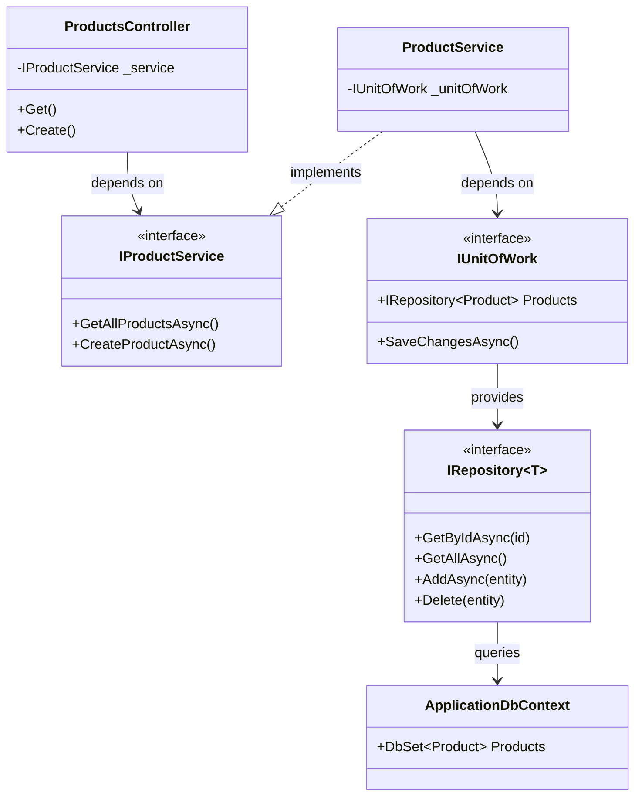
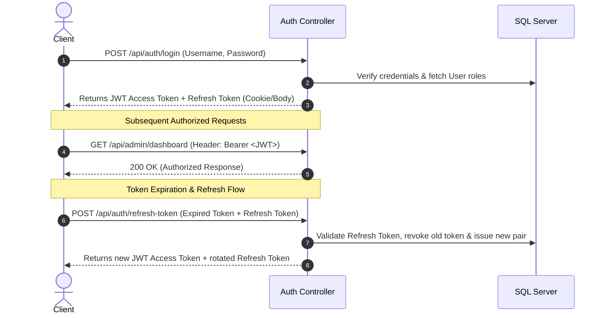

# Building RESTful APIs With ASP.NET Core (.NET 10)

[](https://dotnet.microsoft.com/)
[](https://learn.microsoft.com/en-us/dotnet/csharp/)
[](https://learn.microsoft.com/en-us/aspnet/core/)
[](https://learn.microsoft.com/en-us/ef/core/)
[](https://scalar.com/)
[-brightgreen?style=for-the-badge)](https://github.com/Bhaviik-5202/Building-RESTful-APIs-With-ASP.NET-Core)

A comprehensive, industry-aligned university lab curriculum covering **Lab 01 to Lab 26** for building high-performance, secure, and maintainable RESTful Web APIs using **ASP.NET Core on .NET 10**.

The repository progresses from C# object-oriented engineering fundamentals and Language Integrated Query (LINQ) to production-grade Web API patterns: Entity Framework Core Code-First migrations, automated model validation, unified API envelopes, resilient file streaming, API versioning, JWT authentication with refresh token rotation, and Clean Architecture using the Repository & Unit of Work patterns.

---

## Table of Contents

- [Curriculum Architecture & Roadmap](#curriculum-architecture--roadmap)
- [Lab Directory & Practical Index](#lab-directory--practical-index)
- [Module Highlights](#module-highlights)
  - [1. C# & Object-Oriented Engineering (Labs 01–06)](#1-c-object-oriented-engineering-labs-0106)
  - [2. RESTful API Foundations & EF Core (Labs 07–10)](#2-restful-api-foundations--ef-core-labs-0710)
  - [3. Language Integrated Query - LINQ (Lab 11: Parts 1–3)](#3-language-integrated-query---linq-lab-11-parts-13)
  - [4. Advanced Web API Engineering (Labs 15–21)](#4-advanced-web-api-engineering-labs-1521)
  - [5. Enterprise Security & Architecture (Labs 22–26)](#5-enterprise-security--architecture-labs-2226)
- [Cross-Cutting Patterns](#cross-cutting-patterns)
  - [Standardized API Response Envelope (`ApiResponse<T>`)](#standardized-api-response-envelope-apiresponset)
  - [Clean Architecture & Generic Repository Pattern](#clean-architecture--generic-repository-pattern)
  - [JWT Authentication & Refresh Token Rotation Flow](#jwt-authentication--refresh-token-rotation-flow)
- [Technology Stack](#technology-stack)
- [Getting Started](#getting-started)
  - [Prerequisites](#prerequisites)
  - [Clone & Build](#clone--build)
  - [Running an API Project](#running-an-api-project)
  - [Interactive API Documentation (Scalar)](#interactive-api-documentation-scalar)
- [Build Quality & Verification](#build-quality--verification)
- [Author & Acknowledgments](#author--acknowledgments)

---

## Curriculum Architecture & Roadmap

```mermaid
flowchart TD
    subgraph Phase1["Phase 1: C# & OOP Foundations"]
        L01["Lab 01: Application Design & Prototypes"]
        L02["Lab 02: Loops, Strings & Arrays"]
        L03["Lab 03: Object-Oriented Programming"]
        L04["Lab 04: Inheritance & Abstraction"]
        L05["Lab 05: Exception Handling"]
        L06["Lab 06: Generic Collections"]
        L01 --> L02 --> L03 --> L04 --> L05 --> L06
    end

    subgraph Phase2["Phase 2: RESTful APIs & Data Access"]
        L07["Lab 07: First Web API & Controllers"]
        L08["Lab 08: HTTP Status Codes & REST Conventions"]
        L09["Lab 09: EF Core 10 Code-First & Migrations"]
        L10["Lab 10: Relational CRUD & Dashboard Analytics"]
        L06 --> L07 --> L08 --> L09 --> L10
    end

    subgraph Phase3["Phase 3: Deep-Dive LINQ Engine"]
        L11_1["Lab 11 Part 1: Projections, Filters & Paging"]
        L11_2["Lab 11 Part 2: Grouping & Aggregations"]
        L11_3["Lab 11 Part 3: Relational Joins & Set Operations"]
        L10 --> L11_1 --> L11_2 --> L11_3
    end

    subgraph Phase4["Phase 4: Advanced Web API Engineering"]
        L15_17["Lab 15–17: Unified Response, Binding & Middleware"]
        L18["Lab 18: Resilient Multi-File Upload & Streaming"]
        L19["Lab 19: API Versioning (v1 / v2)"]
        L20_21["Lab 20–21: FluentValidation Pipeline"]
        L11_3 --> L15_17 --> L18 --> L19 --> L20_21
    end

    subgraph Phase5["Phase 5: Security & Enterprise Architecture"]
        L22_24["Lab 22–24: JWT Auth, RBAC & Refresh Token Rotation"]
        L25_26["Lab 25–26: Clean Architecture, Repository & Unit of Work"]
        L20_21 --> L22_24 --> L25_26
    end
```



---

## Lab Directory & Practical Index

| Lab No. | Project Folder | Project Type | Key Technologies & Topics Covered |
|:---:|:---|:---:|:---|
| **01** | [`Lab_01 Application Design`](file:///d:/CSE%20Sem-5%20(A-A2)%20Subject/(ASP.NET)%20ASP.NET%20Core/ASP.NET%20Core%20Lab%20Solution/Lab_01%20Application%20Design) | Prototype / Web | AI-assisted utility design, client-side watermark generator, UI/UX architecture. |
| **02** | [`Lab_02 Loops, Strings & Arrays in C#`](file:///d:/CSE%20Sem-5%20(A-A2)%20Subject/(ASP.NET)%20ASP.NET%20Core/ASP.NET%20Core%20Lab%20Solution/Lab_02%20Loops,%20Strings%20&%20Arrays%20in%20C%23) | Console (.NET 10) | C# 13/14 syntax, control flow, array processing, string algorithms. |
| **03** | [`Lab_03 OOP`](file:///d:/CSE%20Sem-5%20(A-A2)%20Subject/(ASP.NET)%20ASP.NET%20Core/ASP.NET%20Core%20Lab%20Solution/Lab_03%20OOP) | Console (.NET 10) | Classes, objects, parameterized constructors, encapsulation (`Cube`, `Employee`, `Patient`, `PremiumCar`). |
| **04** | [`Lab_04 Inheritance, Abstraction and Interface`](file:///d:/CSE%20Sem-5%20(A-A2)%20Subject/(ASP.NET)%20ASP.NET%20Core/ASP.NET%20Core%20Lab%20Solution/Lab_04%20Inheritance,%20Abstraction%20and%20Interface) | Console (.NET 10) | Polymorphism, abstract classes, interfaces (`Doctor`, `Billing`, `IPatient`). |
| **05** | [`Lab_05 Exception Handling`](file:///d:/CSE%20Sem-5%20(A-A2)%20Subject/(ASP.NET)%20ASP.NET%20Core/ASP.NET%20Core%20Lab%20Solution/Lab_05%20Exception%20Handling) | Console (.NET 10) | Custom domain exceptions, `try-catch-finally`, error propagation, `BankingSystem`. |
| **06** | [`Lab_06 Collection Classes`](file:///d:/CSE%20Sem-5%20(A-A2)%20Subject/(ASP.NET)%20ASP.NET%20Core/ASP.NET%20Core%20Lab%20Solution/Lab_06%20Collection%20Classes) | Console (.NET 10) | Generic collections (`List<T>`, `Dictionary<K,V>`, `HashSet<T>`, `Queue<T>`, `Stack<T>`). |
| **07** | [`Lab_07 Student_API`](file:///d:/CSE%20Sem-5%20(A-A2)%20Subject/(ASP.NET)%20ASP.NET%20Core/ASP.NET%20Core%20Lab%20Solution/Lab_07%20Student_API) | Web API (.NET 10) | Controller routing, HTTP verbs (`GET`, `POST`, `PUT`, `DELETE`), Scalar OpenAPI UI. |
| **08** | [`Lab_08 StudentSubjectAPI_With_HTTP Status Codes`](file:///d:/CSE%20Sem-5%20(A-A2)%20Subject/(ASP.NET)%20ASP.NET%20Core/ASP.NET%20Core%20Lab%20Solution/Lab_08%20StudentSubjectAPI_With_HTTP%20Status%20Codes) | Web API (.NET 10) | RESTful response semantics: `200 OK`, `201 Created`, `204 NoContent`, `400 BadRequest`, `404 NotFound`. |
| **09** | [`Lab_09 Web API With Migration`](file:///d:/CSE%20Sem-5%20(A-A2)%20Subject/(ASP.NET)%20ASP.NET%20Core/ASP.NET%20Core%20Lab%20Solution/Lab_09%20Web%20API%20With%20Migration) | Web API (.NET 10) | Entity Framework Core 10, Code-First migrations, `DbContext`, SQL Server connection pooling. |
| **10** | [`Lab_10 EFCore CRUD`](file:///d:/CSE%20Sem-5%20(A-A2)%20Subject/(ASP.NET)%20ASP.NET%20Core/ASP.NET%20Core%20Lab%20Solution/Lab_10%20EFCore%20CRUD) | Web API (.NET 10) | Relational database CRUD, async EF Core (`SaveChangesAsync`), Dashboard KPI aggregation. |
| **11 (P1)** | [`Lab_11 LINQ Part 1`](file:///d:/CSE%20Sem-5%20(A-A2)%20Subject/(ASP.NET)%20ASP.NET%20Core/ASP.NET%20Core%20Lab%20Solution/Lab_11%20LINQ%20Part%201) | Console (.NET 10) | LINQ filtering (`Where`), projections (`Select`), sorting (`OrderBy`), pagination (`Skip`, `Take`). |
| **11 (P2)** | [`Lab_11 LINQ Part 2`](file:///d:/CSE%20Sem-5%20(A-A2)%20Subject/(ASP.NET)%20ASP.NET%20Core/ASP.NET%20Core%20Lab%20Solution/Lab_11%20LINQ%20Part%202) | Console (.NET 10) | LINQ grouping (`GroupBy`), aggregate operations (`Count`, `Sum`, `Average`, `Min`, `Max`). |
| **11 (P3)** | [`Lab_11 LINQ Part 3_Join`](file:///d:/CSE%20Sem-5%20(A-A2)%20Subject/(ASP.NET)%20ASP.NET%20Core/ASP.NET%20Core%20Lab%20Solution/Lab_11%20LINQ%20Part%203_Join) | Console (.NET 10) | Relational LINQ joins: Inner Join, Group Join, Cross Join, and Left Outer Join. |
| **15–17** | [`Lab_15_17_API_Fundamentals`](file:///d:/CSE%20Sem-5%20(A-A2)%20Subject/(ASP.NET)%20ASP.NET%20Core/ASP.NET%20Core%20Lab%20Solution/Lab_15_17_API_Fundamentals) | Web API (.NET 10) | Standardized `ApiResponse<T>` envelope, Route Constraints, Model Binding (`[FromRoute]`, `[FromQuery]`, `[FromBody]`, `[FromHeader]`, `[FromForm]`). |
| **18** | [`Lab_18_File_Handling`](file:///d:/CSE%20Sem-5%20(A-A2)%20Subject/(ASP.NET)%20ASP.NET%20Core/ASP.NET%20Core%20Lab%20Solution/Lab_18_File_Handling) | Web API (.NET 10) | File upload validation (extensions, MIME, size), streaming downloads, dynamic storage management. |
| **19** | [`Lab_19_API_Versioning`](file:///d:/CSE%20Sem-5%20(A-A2)%20Subject/(ASP.NET)%20ASP.NET%20Core/ASP.NET%20Core%20Lab%20Solution/Lab_19_API_Versioning) | Web API (.NET 10) | `Asp.Versioning.Mvc`, URI path versioning (`/api/v{version}/...`), Header & Query versioning, v1/v2 controller routing. |
| **20–21** | [`Lab_20_21_Validation`](file:///d:/CSE%20Sem-5%20(A-A2)%20Subject/(ASP.NET)%20ASP.NET%20Core/ASP.NET%20Core%20Lab%20Solution/Lab_20_21_Validation) | Web API (.NET 10) | `FluentValidation.AspNetCore`, automatic model validation filters, structured error payloads. |
| **22–24** | [`Lab_22_24_Security`](file:///d:/CSE%20Sem-5%20(A-A2)%20Subject/(ASP.NET)%20ASP.NET%20Core/ASP.NET%20Core%20Lab%20Solution/Lab_22_24_Security) | Web API (.NET 10) | JWT Bearer authentication, claims-based authorization, Role-Based Access Control (`Admin`, `Manager`, `User`), Refresh Token Rotation. |
| **25–26** | [`Lab_25_26_Architecture`](file:///d:/CSE%20Sem-5%20(A-A2)%20Subject/(ASP.NET)%20ASP.NET%20Core/ASP.NET%20Core%20Lab%20Solution/Lab_25_26_Architecture) | Web API (.NET 10) | Clean Architecture, Generic Repository pattern (`IRepository<T>`), Unit of Work (`IUnitOfWork`), Service Layer (`IProductService`), DTO separation. |

---

## Module Highlights

### 1. C# & Object-Oriented Engineering (Labs 01–06)
- **Object Modeling & Encapsulation**: Complete implementation of domain classes featuring automatic and expression-bodied properties, custom constructors, and data encapsulation.
- **Polymorphism & Abstraction**: Implementation of medical clinic models (`Doctor`, `Billing`, `Patient`) showcasing interface contracts, abstract base classes, and virtual method overriding.
- **Domain Exception Handling**: Custom business exception hierarchies (`InsufficientFundsException`, `InvalidTransactionException`) ensuring predictable execution flow without application crashes.
- **High-Performance Collections**: Practical applications of `Dictionary<TKey, TValue>` for O(1) lookups, `HashSet<T>` for unique permission sets, and `Stack<T>`/`Queue<T>` for order-processing workflows.

### 2. RESTful API Foundations & EF Core (Labs 07–10)
- **RESTful Resource Design**: Proper endpoint semantics adhering to Richardson Maturity Model standards.
- **Accurate HTTP Status Codes**: Explicit return codes (`201 Created` with `CreatedAtAction`, `204 NoContent`, `400 BadRequest`, `404 NotFound`).
- **Entity Framework Core 10 Code-First**:
  - Strongly typed `DbContext` with SQL Server connection strings.
  - Snapshot migrations version-controlled in Git.
  - Relational mapping, foreign keys, and indexes.
  - Analytics and Dashboard endpoints aggregating task metrics and completion percentages.

### 3. Language Integrated Query - LINQ (Lab 11: Parts 1–3)
- **Declarative Query Syntax vs. Method Chains**: Comprehensive side-by-side implementations.
- **Partitioning & Projections**: `Skip`, `Take`, `Select`, and anonymous type projections.
- **Relational Operations**: Mastered inner joins, group joins, left outer joins using `DefaultIfEmpty()`, and cross joins.

### 4. Advanced Web API Engineering (Labs 15–21)
- **Unified API Response Envelope**: Consistent response contracts across all endpoints:
  ```json
  {
    "statusCode": 200,
    "isSuccess": true,
    "message": "Resource retrieved successfully",
    "data": { ... },
    "errors": []
  }
  ```
- **Parameter & Model Binding**: Advanced parameter extraction across `[FromRoute]`, `[FromQuery]`, `[FromHeader]`, `[FromBody]`, and `[FromForm]`.
- **Industrial File Handling**: Multi-file streaming, extension whitelist enforcement (`.pdf`, `.jpg`, `.png`), MIME-type validation, and download endpoints returning `FileStreamResult` with appropriate `Content-Disposition`.
- **API Versioning**: Seamless multi-version support (`v1.0` vs. `v2.0`) using `Asp.Versioning.Mvc` and `Asp.Versioning.Mvc.ApiExplorer`.
- **FluentValidation Pipeline**: Clean separation of validation logic from controllers and models with field-specific RFC-7807 error messages.

### 5. Enterprise Security & Architecture (Labs 22–26)
- **JSON Web Token (JWT) Authentication**:
  - Secure claims generation (UserId, Email, Roles).
  - HMAC-SHA256 signature verification.
  - Token expiration and clock-skew tuning.
- **Refresh Token Rotation**: Prevention of replay attacks by issuing single-use refresh tokens stored with database timestamps and revocation flags.
- **Role-Based Access Control (RBAC)**: Fine-grained declarative authorization using `[Authorize(Roles = "Admin,Manager")]`.
- **Clean Architecture & Design Patterns**:
  - **Repository Pattern**: `IRepository<T>` encapsulating data access logic.
  - **Unit of Work Pattern**: `IUnitOfWork` coordinating multiple repositories in a single transactional context.
  - **Service Layer**: `IProductService` holding core business rules, completely decoupling presentation controllers from the database.

---

## Cross-Cutting Patterns

### Standardized API Response Envelope (`ApiResponse<T>`)

```csharp
public class ApiResponse<T>
{
    public int StatusCode { get; set; }
    public bool IsSuccess { get; set; }
    public string Message { get; set; } = string.Empty;
    public T? Data { get; set; }
    public List<string> Errors { get; set; } = new();

    public static ApiResponse<T> Success(T data, string message = "Success", int statusCode = 200)
        => new() { StatusCode = statusCode, IsSuccess = true, Message = message, Data = data };

    public static ApiResponse<T> Failure(string error, int statusCode = 400)
        => new() { StatusCode = statusCode, IsSuccess = false, Message = error, Errors = [error] };
}
```

### Clean Architecture & Generic Repository Pattern



### JWT Authentication & Refresh Token Rotation Flow



---

## Technology Stack

- **Platform & Runtime**: [.NET 10.0 (net10.0)](https://dotnet.microsoft.com/)
- **Programming Language**: [C# 13 / 14](https://learn.microsoft.com/en-us/dotnet/csharp/)
- **Web Framework**: [ASP.NET Core Web API](https://learn.microsoft.com/en-us/aspnet/core/)
- **Data Access & ORM**: [Entity Framework Core 10](https://learn.microsoft.com/en-us/ef/core/)
  - `Microsoft.EntityFrameworkCore.SqlServer` (10.0.12)
  - `Microsoft.EntityFrameworkCore.Tools` (10.0.12)
- **API Documentation & Testing**:
  - `Microsoft.AspNetCore.OpenApi` (10.0.12)
  - `Scalar.AspNetCore` (2.16.18)
- **Validation**:
  - `FluentValidation.AspNetCore` (11.3.11)
- **API Versioning**:
  - `Asp.Versioning.Mvc` (8.1.0)
  - `Asp.Versioning.Mvc.ApiExplorer` (8.1.0)
- **Security & Tokens**:
  - `Microsoft.AspNetCore.Authentication.JwtBearer` (10.0.12)
  - `System.IdentityModel.Tokens.Jwt` (8.16.0)

---

## Getting Started

### Prerequisites

1. [.NET 10.0 SDK](https://dotnet.microsoft.com/download/dotnet/10.0) or higher.
2. [SQL Server](https://www.microsoft.com/en-us/sql-server) or SQL Server Express / LocalDB.
3. An IDE of your choice:
   - [Visual Studio 2026](https://visualstudio.microsoft.com/) (with ASP.NET & Web Development workload)
   - [Visual Studio Code](https://code.visualstudio.com/) with C# Dev Kit extension
   - [JetBrains Rider](https://www.jetbrains.com/rider/)

### Clone & Build

```bash
# Clone the repository
git clone https://github.com/Bhaviik-5202/Building-RESTful-APIs-With-ASP.NET-Core.git
cd Building-RESTful-APIs-With-ASP.NET-Core

# Build any individual lab (e.g., Lab 25–26 Clean Architecture)
dotnet build "Lab_25_26_Architecture/Lab_25_26_Architecture.csproj"
```

To build all projects in the solution in a single command using PowerShell:
```powershell
Get-ChildItem -Filter *.csproj -Recurse | ForEach-Object { dotnet build $_.FullName }
```

### Running an API Project

Navigate into any Web API project folder and execute `dotnet run`:

```bash
cd "Lab_22_24_Security"
dotnet run
```

Example startup console output:
```text
info: Microsoft.Hosting.Lifetime[14]
      Now listening on: https://localhost:7088
      Now listening on: http://localhost:5260
info: Microsoft.Hosting.Lifetime[0]
      Application started. Press Ctrl+C to shut down.
info: Microsoft.Hosting.Lifetime[0]
      Hosting environment: Development
```

### Interactive API Documentation (Scalar)

All Web API projects in this repository are equipped with **Scalar** OpenAPI documentation. 

Once an API project is running, open your browser and navigate to:
```text
https://localhost:<port>/scalar/v1
```
*(Replace `<port>` with the active HTTPS port displayed in the console output).*

---

## Build Quality & Verification

Every project in this repository has been rigorously audited and compiles with:
- **0 Compilation Errors**
- **0 Compiler Warnings**
- **0 Vulnerability Warnings (NuGet NU1903/NU1904 clean)**
- **Strict Nullability Checks (`<Nullable>enable</Nullable>`)**

```text
Build Summary:
  Projects Audited : 18 Projects
  Compiles Cleanly : 18 / 18
  Warnings         : 0 Warning(s)
  Errors           : 0 Error(s)
```

---

## Author & Acknowledgments

- **Author**: Bhavik Parmar
- **GitHub**: [@Bhaviik-5202](https://github.com/Bhaviik-5202)
- **Repository**: [Building-RESTful-APIs-With-ASP.NET-Core](https://github.com/Bhaviik-5202/Building-RESTful-APIs-With-ASP.NET-Core)
- **Academic Context**: B.Tech Computer Science & Engineering (Semester 5) — ASP.NET Core Lab Practical Curriculum.
